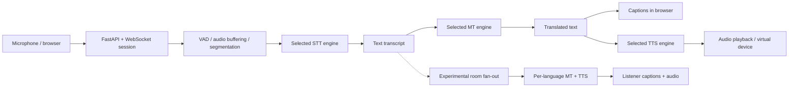

<div align="center">

# BP · Live Speech Translation

**A local-first speech translation orchestrator for calls, presentations and multilingual rooms.**

Connect speech recognition, machine translation and speech synthesis engines; deliver translated captions and audio through a browser.

[**Watch demo**](https://www.youtube.com/watch?v=MvxVdjCIrx8) · [**Product site**](https://brusnyak.github.io/bp/) · [**Architecture**](#architecture) · [**Results & data**](#results--data)


[](LICENSE)


[](https://www.youtube.com/watch?v=MvxVdjCIrx8)

*Recorded demo: English → Slovak. Click the image to watch on YouTube.*

</div>

## Capabilities

| **Orchestrate models** | **Translate live** | **Connect audiences** |
| :--- | :--- | :--- |
| Configure STT, MT and TTS engines by route and hardware | Stream captions and generated speech; route audio into meeting software | Share room links/QR codes; multi-listener mode is **experimental** |

## Architecture



**Control plane:** [engine registry](backend/registry.py), [language packs](languages/packs/), hardware presets and model selection. **Streaming path:** [session server](app.py), [backend pipeline](backend/streaming/pipeline.py), [room fan-out](backend/room.py).

**Important boundaries:** This is an orchestration application, not a new foundation speech model. The currently implemented live route chains **STT → MT → TTS**. Alternative recognition and voice engines have different levels of integration and testing. The registry also describes **unified speech-to-speech candidates**, but its Qwen3-Omni and SeamlessM4T v2 adapters are **declared only**, not runnable live routes. Engine registration does not mean installation, compatibility, or benchmark validation.

[Architecture details](documentation/technical_report.md) · [Integrations and wire protocol](documentation/INTEGRATION.md) · [API/SDK](documentation/sdk.md)

## Quick start

**Requirements:** Git, Python 3.11 or 3.12, ffmpeg, and internet/disk space for first-time dependency and model downloads.

```bash
git clone https://github.com/brusnyak/bp.git
cd bp
```

Pick **one** hardware profile:

| Hardware | Setup | Start |
| :--- | :--- | :--- |
| Apple Silicon (macOS) | `python scripts/setup.py --profile mac` | `python scripts/run.py --profile mac` |
| NVIDIA CUDA (Windows/Linux) | `python scripts/setup.py --profile nvidia` | `python scripts/run.py --profile nvidia` |
| CPU (Windows/macOS/Linux) | `python scripts/setup.py --profile cpu` | `python scripts/run.py --profile cpu` |

Setup creates `.venv`, downloads model assets and runs a self-test; the separate launcher loads the corresponding `presets/<profile>.env` on all three operating systems. Use `python3.11` instead of `python` where required. Add `--langs cs,sk,de` to setup to choose language packs (default: `de,sk,cs`; other available packs: `fr,pl`).

Open **http://localhost:8000** in **Chrome or Edge**. Choose your speech route and devices, test your microphone, use headphones and start translating. GPU setup, route latency and model availability are hardware-dependent; this table is **not** a claim of tested fresh installs for every combination.

[Language coverage](documentation/LANGUAGES.md) · [Send audio to a call / room](documentation/INTEGRATION.md) · [Known limitations](documentation/ROUTE_LIMITS_2026-11-17.md)

## Results & data

**English → Slovak, recorded replay on Mac M1 Pro.** One run per configuration, generated English audio (not a live participant).

| Configuration | Median measured lag | p90 lag | Recognition WER |
| :--- | ---: | ---: | ---: |
| Baseline | 0.75 s | 1.80 s | 5.2% |
| Wait 0.5 s | **0.79 s** | **1.39 s** | 5.2% |

[Baseline result](documentation/evidence/2026-11-15/A_baseline.score.txt) · [Wait 0.5 result](documentation/evidence/2026-11-15/D_wait05.score.txt) · [Run artifacts](documentation/evidence/2026-11-15/)

| Other evaluated work | Measured scope | Source |
| :--- | :--- | :--- |
| Live English → German | <!-- claim:route:en-de|agree10:lag -->1.56<!-- /claim --> s median segment-end lag, 1.0 s agreement, Kaggle T4; one route configuration | [Server-route benchmarks](documentation/BENCHMARKS.md) |
| Recognition and translation | FLEURS recognition clips (60 per language); OPUS-100 translation examples, WER and chrF | [Language matrix](documentation/LANGUAGES.md) |
| Streaming / chain behavior | Speech chunking vs agreement, 25-clip whole-chain timings, per-stage and queue measurements | [Methods & data](documentation/BENCHMARKS.md) |

Measurements of transcription error, translation quality, model speed, speech onset and end-to-end lag are **different metrics**. Saved tests do not establish continuous deployment quality, cloned-voice identity, or room capacity.

[**All benchmark methods & receipts**](documentation/INDEX.md#understand-the-measurements) · [**Route status**](documentation/STATUS.md) · [**Full documentation**](documentation/INDEX.md)

## Licences & deployment

**BP repository code is MIT; that does not relicense third-party engines, model weights, voices or data.** BP selects and invokes local dependencies and downloads some through its setup scripts. The application is an orchestrator, but *being a middle layer does not automatically remove distribution, attribution, commercial-use, or copyleft obligations*.

- **Default stack:** Whisper / faster-whisper or MLX, Opus-MT and Piper, depending on profile and language. Piper's runtime is GPL-3.0-or-later; voice weights and translation checkpoints have their **own** terms.
- **Optional models:** some are non-commercial, unknown-licence, experimental, or declared-only. The current engine registry **warns rather than blocks** selection of non-commercial/unknown licences; it is **not** a legal-compliance gate.
- **Distribution:** first-party code licence and third-party obligations must be reviewed separately before distributing a bundle or using models commercially. Model downloads, local inference and deployment are not interchangeable licensing cases.

[Third-party NOTICE](NOTICE.md) · [Licence inventory (verify current model cards)](documentation/LICENSE_INVENTORY_2026-11-06.md) · [Registry metadata](backend/registry.py)

## Evidence transparency

The 5.2% recognition WER above is from **generated English replay** (`D_wait05` vs `A_baseline`), not real microphone speech. On the real route (Kaggle T4 server, owner English reading) transcript error is **23.0-23.8%** (`route_test.json`, `BENCHMARKS.md` #2b), about 4x the offline simulation. Real-mic Slovak input scores **17.7-45%** depending on engine (`LANGUAGES.md`, `STATUS.md` strategy lab). These are different data and clocks; they are not merged into one headline number.

Room mode is built and unit-tested, with two Kaggle T4 real-model runs (speaker lag 5.64 s for 3 listeners, 7.31 s for 12 listeners; `evidence/2026-11-09/room_test_t4_log.json`, `evidence/2026-11-10/room_test_t4_v3.json`), but it has **not** been verified with real listeners in front of real devices (`STATUS.md` room-mode requirements #1 open).

Nemotron 3.5 ASR 0.6B shows good EN→SK lag on real Mac speech (**1.10 s** median, `route_nemotron_en_sk_real_speech_mac.json`) but SK word error **0.86/0.75 with language drift** on the maintainer mic (`model_landscape_2026-10.md`); its latency is measured, its live-route SK accuracy is not validated.

Full receipts: `documentation/evidence/2026-11-15/`, `documentation/evidence/2026-11-07/`, `documentation/evidence/2026-11-09/`, `documentation/evidence/2026-11-10/`. Consolidated audit: `AUDIT_EVIDENCE_ROUTES_2026-11-19.md`.

<details>
<summary><b>Developer commands and limitations</b></summary>

```bash
python scripts/setup.py --dev --profile cpu
python scripts/check_readme_claims.py
python scripts/check_public_tree.py
# POSIX shell / Make environment:
make test
```

Run tests through the virtualenv Python on Windows (see [CI](.github/workflows/ci.yml)). Model choice and language coverage are not guaranteed by registry entries alone. Room mode requires real-model and real-listener validation. For shared use, define access, consent and data-retention policies.

</details>

---

<sub>Created by [Yegor Brusnyak](https://github.com/brusnyak) · [MIT code licence](LICENSE)</sub>
