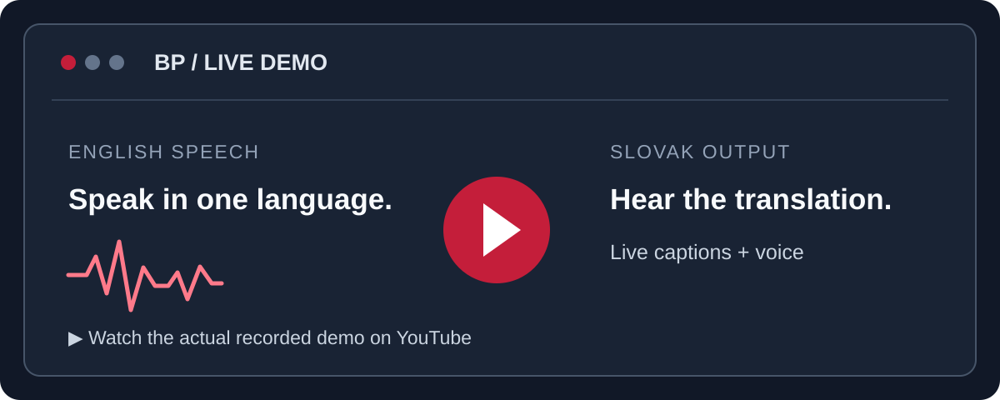
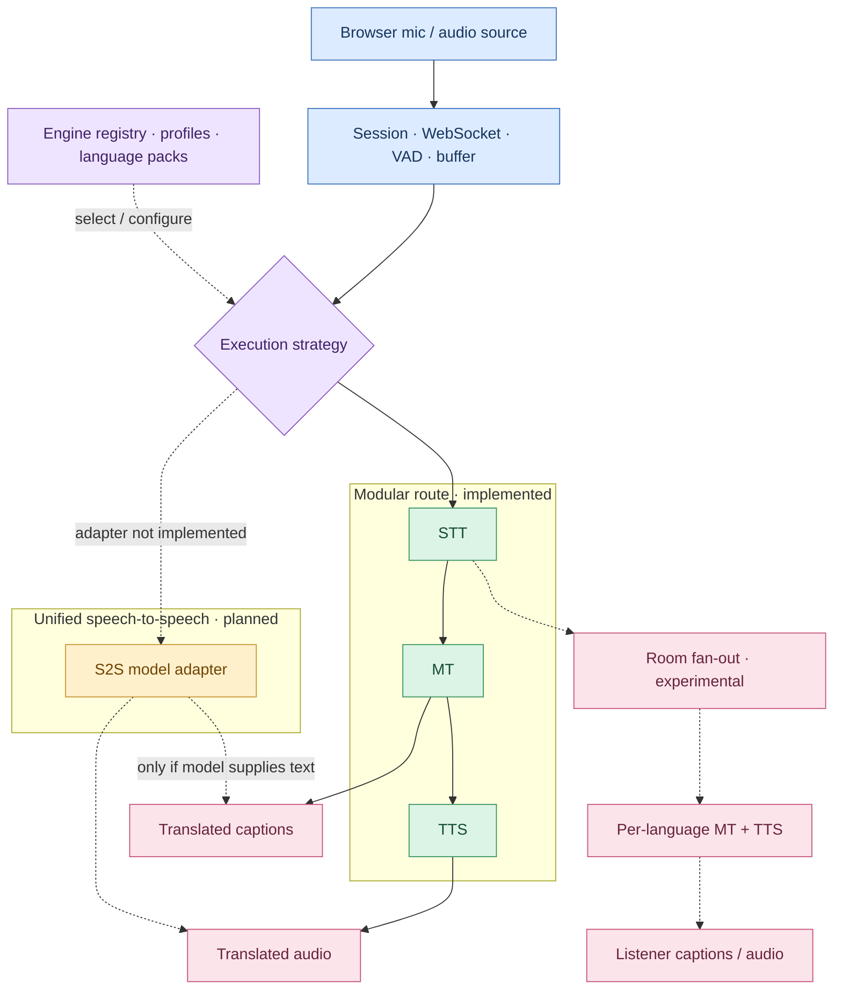

<div align="center">

# BP · Live Speech Translation

**Local-first speech translation · modular engines · experimental audience routing.**

Connect speech recognition, translation and speech synthesis; deliver captions and audio through a browser.

[**Watch demo**](https://www.youtube.com/watch?v=MvxVdjCIrx8) · [**Product site**](https://brusnyak.github.io/bp/) · [**Architecture**](#architecture) · [**Results & data**](#results--data)


[](LICENSE)


[](https://www.youtube.com/watch?v=MvxVdjCIrx8)

*Recorded demo: English → Slovak. Click the image to watch on YouTube.*

</div>

## Capabilities

| **Orchestrate models** | **Translate live** | **Connect audiences** |
| :--- | :--- | :--- |
| Configure STT, MT and TTS engines by route and hardware | Stream captions and generated speech; route audio into meeting software | Share room links/QR codes; multi-listener mode is **experimental** |

## Architecture



**Execution:** [streaming pipeline](backend/streaming/pipeline.py) · [model registry](backend/registry.py) · [room delivery](backend/room.py) · [API](documentation/INTEGRATION.md). BP routes **third-party engines**; it is not itself a foundation model.

**Status:** modular STT → MT → TTS is implemented. Room fan-out is experimental. Unified S2S is an **integration target**, not a working live adapter; model-dependent captions and voice identity are not guaranteed. [More detail](documentation/technical_report.md).

## Quick start

**Requirements:** Git, Python 3.11 or 3.12, ffmpeg, and internet/disk space for first-time dependency and model downloads.

```bash
git clone https://github.com/brusnyak/bp.git
cd bp
```

Pick **one** hardware profile:

| Hardware | Setup | Start |
| :--- | :--- | :--- |
| Apple Silicon (macOS) | `python scripts/setup.py --profile mac` | `python scripts/run.py --profile mac` |
| NVIDIA CUDA (Windows/Linux) | `python scripts/setup.py --profile nvidia` | `python scripts/run.py --profile nvidia` |
| CPU (Windows/macOS/Linux) | `python scripts/setup.py --profile cpu` | `python scripts/run.py --profile cpu` |

Setup creates `.venv`, downloads model assets and runs a self-test; the separate launcher loads the corresponding `presets/<profile>.env` on all three operating systems. Use `python3.11` instead of `python` where required. Add `--langs cs,sk,de` to setup to choose language packs (default: `de,sk,cs`; other available packs: `fr,pl`).

Open **http://localhost:8000** in **Chrome or Edge**. Choose your speech route and devices, test your microphone, use headphones and start translating. GPU setup, route latency and model availability are hardware-dependent; this table is **not** a claim of tested fresh installs for every combination.

[Language coverage](documentation/LANGUAGES.md) · [Send audio to a call / room](documentation/INTEGRATION.md) · [Known limitations](documentation/ROUTE_LIMITS_2026-11-17.md)

## Results & data

**Measured routes** · latency is measured *after a speech segment ends*, not word-to-word translation delay.

| Route | Test & hardware | Median lag | p90 | Recognition WER |
| :--- | :--- | ---: | ---: | ---: |
| EN → SK | Generated 60 s replay · M1 Pro, MLX | **0.79 s** | 1.39 s | 5.2% |
| EN → SK | Real recorded speech · T4, Whisper agree 1.0 s | 1.89 s | 3.10 s | 23.0% |
| EN → DE | Real recorded speech · T4, Whisper agree 1.0 s | 1.56 s | 2.55 s | 21.3% |

Sources: [Mac replay receipt](documentation/evidence/2026-11-15/D_wait05.score.txt) · [T4 server route data](documentation/evidence/2026-11-07/route_test.json) · [audit / test definitions](AUDIT_EVIDENCE_ROUTES_2026-11-19.md). **These are different tests; do not compare them as one leaderboard.**

**Multilingual recognition** · offline FLEURS, Kaggle T4, 60 clips per language. WER ↓ (not full live-route performance).

| EN | DE | FR | PL | CS | SK |
| ---: | ---: | ---: | ---: | ---: | ---: |
| 4.5% | 4.8% | 5.0% | 7.7% | 11.6% | 6.5% |

Different best-performing recognizers are used by language; SK uses a Slovak fine-tune. [Models & methods](documentation/LANGUAGES.md) · [Raw component evidence](documentation/evidence/2026-11-07/lang_matrix.json).

**Known gaps:** real-speech accuracy differs substantially from clean replay; room-mode T4 experiments reached **4.0–7.31 s** median speaker lag under tested configurations and have no real-device listener validation. See the [evidence audit](AUDIT_EVIDENCE_ROUTES_2026-11-19.md) before claiming production-grade multilingual performance.

## Licences & deployment

**BP repository code is MIT; that does not relicense third-party engines, model weights, voices or data.** BP selects and invokes local dependencies and downloads some through its setup scripts. The application is an orchestrator, but *being a middle layer does not automatically remove distribution, attribution, commercial-use, or copyleft obligations*.

- **Default stack:** Whisper / faster-whisper or MLX, Opus-MT and Piper, depending on profile and language. Piper's runtime is GPL-3.0-or-later; voice weights and translation checkpoints have their **own** terms.
- **Optional models:** some are non-commercial, unknown-licence, experimental, or declared-only. The current engine registry **warns rather than blocks** selection of non-commercial/unknown licences; it is **not** a legal-compliance gate.
- **Distribution:** first-party code licence and third-party obligations must be reviewed separately before distributing a bundle or using models commercially. Model downloads, local inference and deployment are not interchangeable licensing cases.

[Third-party NOTICE](NOTICE.md) · [Licence inventory (verify current model cards)](documentation/LICENSE_INVENTORY_2026-11-06.md) · [Registry metadata](backend/registry.py)

<details>
<summary><b>Developer commands and limitations</b></summary>

```bash
python scripts/setup.py --dev --profile cpu
python scripts/check_readme_claims.py
python scripts/check_public_tree.py
# POSIX shell / Make environment:
make test
```

Run tests through the virtualenv Python on Windows (see [CI](.github/workflows/ci.yml)). Model choice and language coverage are not guaranteed by registry entries alone. Room mode requires real-model and real-listener validation. For shared use, define access, consent and data-retention policies.

</details>

---

<sub>Created by [Yegor Brusnyak](https://github.com/brusnyak) · [MIT code licence](LICENSE)</sub>
