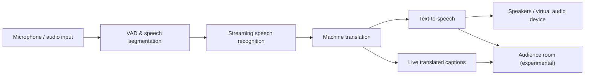

<div align="center">

# BP · Real-Time Speech Translation

**Translate speech into live captions and spoken audio — locally.**

For presentations, calls and multilingual audiences. A research prototype built around a configurable streaming pipeline.

[**Watch the demo**](https://www.youtube.com/watch?v=MvxVdjCIrx8) · [**Product site**](https://brusnyak.github.io/bp/) · [**Documentation**](documentation/INDEX.md)


[](LICENSE)


</div>

## At a glance

| **Local pipeline** | **Live output** | **Flexible deployment** |
| :--- | :--- | :--- |
| Speech recognition → translation → voice, without a cloud speech API | Captions, synthesized speech and experimental audience broadcast | CPU, Apple Silicon and NVIDIA profiles; browser control |

**[See English → Slovak demo on YouTube](https://www.youtube.com/watch?v=MvxVdjCIrx8)** · No letterboxed video thumbnail in this README.

## System design



- **Backend:** Python, FastAPI and WebSockets; modular STT, MT and TTS engines.
- **Models:** Whisper / MLX or faster-whisper by profile, Opus-MT translation and generic Piper voices. Experimental alternatives have separate setup and evidence.
- **Delivery:** Browser interface, audio-device routing into meeting software and experimental room listeners.

[Technical design](documentation/technical_report.md) · [Integration & WebSocket contract](documentation/INTEGRATION.md) · [API / SDK](documentation/sdk.md)

## Quick start

**Prerequisites:** Git, Python **3.11 or 3.12**, ffmpeg and disk space for downloaded models. First setup requires internet access; processing runs locally after model installation.

**1. Clone**

```bash
git clone https://github.com/brusnyak/bp.git
cd bp
```

**2. Choose your hardware and install**

| Platform / hardware | Setup command |
| :--- | :--- |
| macOS · Apple Silicon | `python scripts/setup.py --profile mac --langs cs,sk,de` |
| Windows / Linux · NVIDIA CUDA | `python scripts/setup.py --profile nvidia --langs cs,sk,de` |
| Windows / Linux / macOS · CPU | `python scripts/setup.py --profile cpu --langs cs,sk,de` |

Run the command in your terminal with **Python 3.11/3.12** on PATH. On macOS/Linux, use `python3.11` instead of `python` if needed. The setup script creates `.venv`, installs dependencies and fetches language models; it may take time and substantial storage. `--langs` supports `cs,de,sk,fr,pl`; English is bundled. Platform-specific GPU dependencies and model readiness still need to be verified on your machine.

**3. Start — same command on every OS**

```bash
python scripts/run.py --profile cpu
```

Replace `cpu` with **`mac`** or **`nvidia`** to match step 2. The launcher loads the matching `presets/<profile>.env` and starts the virtualenv server; no Makefile or POSIX shell required.

Open **http://localhost:8000** in Chrome or Edge, choose languages and audio devices, test your mic, and press **Start**. Wear headphones to prevent feedback.

[Supported language routes & hardware](documentation/LANGUAGES.md) · [Meeting/room audio routing](documentation/INTEGRATION.md) · [Troubleshooting & project status](documentation/STATUS.md)

## Benchmarks & data

**Observed route latency — English → Slovak, Mac M1 Pro, paced generated audio (one run per setting).** Lower is better. Measurements cover this test, not guaranteed sustained meeting performance.

| Route setting | Median lag | p90 lag | Recognition WER |
| :--- | ---: | ---: | ---: |
| Previous baseline | 0.75 s | 1.80 s | 5.2% |
| Wait 0.5 s | **0.79 s** | **1.39 s** | 5.2% |

[Raw baseline receipt](documentation/evidence/2026-11-15/A_baseline.score.txt) · [Raw tuned receipt](documentation/evidence/2026-11-15/D_wait05.score.txt) · [All Nov 15 runs](documentation/evidence/2026-11-15/)

**Other reproducible evaluations**

| Evaluation | Example result / scope | Data & methodology |
| :--- | :--- | :--- |
| Live server, English → German | **1.56 s** median segment-end lag on a Kaggle T4 with 1.0 s agreement; one tested route configuration | [Benchmark methods](documentation/BENCHMARKS.md) |
| Recognition + translation quality | FLEURS speech clips (60/language), OPUS-100 translation sentences; WER / chrF reported separately | [Language results](documentation/LANGUAGES.md) |
| End-to-end & streaming strategies | 25-clip chain timings; paced playback, queue behavior and latency/error tradeoffs | [Benchmarks](documentation/BENCHMARKS.md) |

**Reading the numbers:** recognition WER ≠ translation accuracy; component processing time ≠ observed live delay. See [evidence index](documentation/INDEX.md#understand-the-measurements) for hardware, datasets, raw results and limitations.

## Project references

[**Docs index**](documentation/INDEX.md) · [**Architecture**](documentation/technical_report.md) · [**Routes**](documentation/LANGUAGES.md) · [**Benchmarks**](documentation/BENCHMARKS.md) · [**API**](documentation/sdk.md) · [**Licence inventory**](documentation/LICENSE_INVENTORY_2026-11-06.md)

<details>
<summary><b>Development commands</b></summary>

```bash
python scripts/setup.py --dev --profile cpu
make test                 # POSIX shell / Make required
make check-docs           # validate marked documentation claims
python scripts/check_site_links.py
python scripts/check_public_tree.py
```

On Windows, run test suites via the virtualenv Python instead of relying on Make. See [CI workflow](.github/workflows/ci.yml) for platform-specific commands.

</details>

<details>
<summary><b>Privacy, experimental features & licence restrictions</b></summary>

- Speech processing uses local models by default; initial setup downloads model assets. Shared deployments need access, consent, and retention controls.
- Experimental: room broadcast, Slovak speech output/input quality, and some recognition engines / personal voice choices. Installing a model is not proof of live-route quality.
- The Nemotron configuration shown in some product-site results is separately provisioned; the standard setup does not install it automatically.
- **Code is MIT; model and voice licences differ.** Piper runtime, XTTS v2 and X-Voice have separate restrictions, including non-commercial terms. Review [NOTICE](NOTICE.md) and [licences](documentation/LICENSE_INVENTORY_2026-11-06.md) before redistribution or commercial use.

</details>

---

<sub>Created by [Yegor Brusnyak](https://github.com/brusnyak) · [MIT code licence](LICENSE)</sub>
